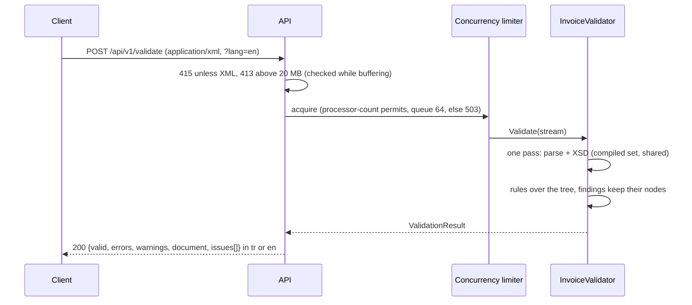

# ubltr-validator

[](https://github.com/hekimcan206/ubltr-validator/actions/workflows/ci.yml)
[](https://github.com/hekimcan206/ubltr-validator/actions/workflows/codeql.yml)


[](LICENSE)

A validator for Turkish **e-Fatura** and **e-Arşiv** invoices in UBL-TR format. It checks a document against GIB's
UBL-TR 1.2.1 XSDs and 49 business rules, and explains every finding in Turkish (or English) with the exact value,
the location and **how to fix it**. It runs as a CLI, an HTTP API and a GitHub Action.

> All data is synthetic: invoices, companies, people and tax numbers are generated. There is no real personal or
> business data. GIB's own files are downloaded at build time and never committed.

*Terms: GIB (Gelir İdaresi Başkanlığı) is the Turkish Revenue Administration. e-Fatura is the mandatory B2B e-invoice
exchanged through GIB; e-Arşiv is the e-invoice issued to parties outside that system (typically consumers). UBL-TR is
GIB's profile of OASIS UBL 2.1. VKN is the 10-digit tax number of a business, TCKN the 11-digit national ID number of a
person. KVKK is Türkiye's personal data protection law.*

## Problem

An invoice that GIB or the buyer rejects costs a correction cycle: a cancellation, a return invoice or a phone call
with the buyer's accounting department. The checks available to an integration team today have three gaps:

1. **The official rules explain nothing.** GIB publishes its business rules as ISO Schematron. A failing assertion
   says *"Geçersiz cbc:ID elemanı değeri"* (invalid cbc:ID value): Turkish only, no location, no hint what a valid value
   looks like, nothing for the developer who does not read Turkish.
2. **Nobody adds the numbers up.** GIB's Schematron checks codes and structure, never arithmetic. An invoice whose
   lines do not add up to `LineExtensionAmount`, whose VAT is not base x rate, or whose payable amount forgets the
   withheld VAT passes it, and is then rejected by the buyer. GIB's own demo invoices contain such slips
   ([docs/gib-samples.md](docs/gib-samples.md)).
3. **It runs too late.** Errors show up when the integrator's portal rejects a live invoice, not when a developer
   changes the code that produces it.

## Solution

| Concern | How |
|---|---|
| Official structure | XSD validation against GIB's UBL-TR 1.2.1 schema set (`xsdrt/`), compiled once and shared |
| Official business rules | 30 rules that re-implement named assertions of GIB's Schematron (`InvoiceIDCheck`, `ProfileIDCheck`, `WithholdingTaxTotalCheck`, ...), with code lists read from GIB's own `UBL-TR_Codelist.xml` ([ADR 0001](docs/adr/0001-business-rules-in-csharp-mapped-to-gib-schematron.md)) |
| What GIB does not check | 13 consistency rules and 2 rules derived from GIB code lists: VKN/TCKN check digits, line amount = quantity x price, lines vs `LegalMonetaryTotal`, the totals chain down to `PayableAmount`, tax = base x rate, document vs line tax breakdowns, currencies, with kuruş-level tolerances and GIB's own conventions ([ADR 0004](docs/adr/0004-rounding-tolerance-and-gib-conventions.md)) |
| Explanations | Every finding: rule id, title, a message with the actual values, why the rule exists, and a concrete fix, in Turkish (default) or English, with line, column and path. XSD errors are translated too ([ADR 0005](docs/adr/0005-stable-rule-ids-bilingual-messages-and-golden-samples.md)) |
| Early feedback | A composite GitHub Action that annotates the failing line in the pull request ([ADR 0006](docs/adr/0006-composite-action-built-from-source.md)) |
| Safe parsing | DTD/XXE refused, `xsi:schemaLocation` ignored, schema imports confined, size and concurrency limits ([threat model](docs/threat-model.md)) |
| No redistribution | GIB's packages are downloaded at build time and checked against pinned SHA-256 hashes ([ADR 0002](docs/adr/0002-fetch-gib-packages-at-build-time.md), [docs/gib-package.md](docs/gib-package.md)) |

## What a finding looks like

```text
$ ubltr validate samples/invoices/valid/temel-tevkifat.xml samples/invoices/invalid/TOT-002.xml samples/invoices/invalid/PTY-003.xml
GEÇERSİZ           samples/invoices/invalid/PTY-003.xml  1 hata, 0 uyarı
  hata    PTY-003  satır 69:10  VKN kontrol hanesi hatalı
          Alıcı (AccountingCustomerParty) VKN '9876543218' geçersiz: kontrol hanesi 7 olmalı.
          Neden: VKN'nin son hanesi ilk dokuz haneden hesaplanan kontrol hanesidir; uyuşmaması genellikle yazım hatasıdır. GİB şematronu yalnızca uzunluğu denetler.
          Çözüm: VKN'yi vergi levhası veya GİB mükellef sorgusundan doğrulayıp yeniden yazın.
          Yol: /Invoice/cac:AccountingCustomerParty/cac:Party/cac:PartyIdentification/cbc:ID
GEÇERSİZ           samples/invoices/invalid/TOT-002.xml  1 hata, 0 uyarı
  hata    TOT-002  satır 127:6  Satır toplamı LegalMonetaryTotal ile uyuşmuyor
          LegalMonetaryTotal/cbc:LineExtensionAmount 12306.33, satırların toplamı 12296.33.
          Neden: LegalMonetaryTotal/LineExtensionAmount, tüm satırların LineExtensionAmount toplamına eşit olmalıdır.
          Çözüm: Toplamı 12296.33 yapın ya da eksik/fazla satırı düzeltin.
          Yol: /Invoice/cac:LegalMonetaryTotal/cbc:LineExtensionAmount
GEÇERLİ            samples/invoices/valid/temel-tevkifat.xml  0 hata, 0 uyarı

3 dosya: 1 geçerli, 2 geçersiz
```

The same in English (`--lang en`):

```text
  error   TAX-007  line 97:10  Exemption code does not fit the invoice type
          Exemption code '301' cannot be used with invoice type 'SATIS'. Allowed types: ISTISNA, IADE, IHRACKAYITLI, SGK, YTBISTISNA, YTBIADE.
          Why: Exemption codes belong to type ISTISNA, special-base codes (801-812) to OZELMATRAH and export-registered codes (701-704) to IHRACKAYITLI (plus IADE/SGK).
          Fix: Change the invoice type to one of ISTISNA, IADE, IHRACKAYITLI, SGK, YTBISTISNA, YTBIADE or choose the right exemption code.
```

## Architecture

```mermaid
flowchart LR
    subgraph build["build time (once, cached)"]
        gib["ebelge.gib.gov.tr<br/>UBL-TR 1.2.1 package<br/>e-Fatura package"] -->|curl + SHA-256 pin| cache[".gib/ (git-ignored)"]
        cache -->|xsdrt/*.xsd, UBL-TR_Codelist.xml| out["bin/.../gib/"]
    end
    subgraph run["run time"]
        cli["ubltr CLI<br/>files, dirs, globs"] --> core
        api["HTTP API<br/>POST /api/v1/validate"] --> core
        action["GitHub Action<br/>(composite, builds the CLI)"] --> cli
        core["InvoiceValidator"] --> reader["XmlReader<br/>DTD prohibited<br/>+ XSD validation"]
        reader --> tree["XDocument<br/>(line info)"]
        tree --> rules["49 rules<br/>header, parties, currency,<br/>totals, tax"]
        rules --> report["ValidationResult<br/>(language-neutral)"]
        report -->|ToReport(tr/en)| out2["text / JSON / GitHub annotations"]
    end
    out -.-> core
```



## Quick start

Prerequisites: .NET SDK 10.0.4xx and network access to ebelge.gib.gov.tr for the first build (the GIB packages are
downloaded and cached in `.gib/`).

```bash
dotnet build
dotnet run --project src/UblTr.Cli -- validate samples/invoices          # Turkish
dotnet run --project src/UblTr.Cli -- validate "invoices/**/*.xml" --lang en --format json
dotnet run --project src/UblTr.Cli -- rules                              # every rule with its origin
dotnet run --project src/UblTr.Cli -- explain TAX-009
```

Exit codes: `0` all valid, `1` findings (errors, or warnings with `--fail-on warning`), `2` usage or setup problem.

### HTTP API

```bash
docker compose up        # API on http://localhost:58380, OpenAPI UI at /scalar/v1; a CLI demo prints sample findings
curl -s -X POST -H 'Content-Type: application/xml' --data-binary @samples/invoices/invalid/TAX-004.xml \
  'http://localhost:58380/api/v1/validate?lang=en'
```

| Endpoint | Purpose |
|---|---|
| `POST /api/v1/validate?lang=tr\|en&kind=auto\|efatura\|earsiv` | Validate the raw XML body. 200 with the report (a failed validation is not an HTTP error); 413, 415, 503 as problem details |
| `GET /api/v1/rules?lang=` / `GET /api/v1/rules/{id}` | Rule catalog |
| `GET /health/live`, `GET /health/ready` | Probes (ready = GIB XSDs compiled) |

### GitHub Action

```yaml
- uses: actions/checkout@v7
- uses: hekimcan206/ubltr-validator@v1
  with:
    paths: |
      invoices/**/*.xml
    lang: tr            # or en
    kind: auto          # efatura | earsiv
    fail-on: error      # or warning
    # disable: PTY-003  # e.g. for fixtures with placeholder tax numbers
```

Findings appear as annotations on the changed lines and as a table in the job summary; the `report` output is the
JSON report. A complete workflow is in [samples/workflows/validate-invoices.yml](samples/workflows/validate-invoices.yml),
and this repository's CI runs the action against its own samples (`uses: ./`).

## Rules

| Category | Rules | Origin |
|---|---|---|
| Structure | XML-001 well-formed, XML-002 no DTD/entities, DOC-001 root is a UBL Invoice, XSD-001 UBL-TR XSD | structure |
| Header | HDR-001 UBLVersionID, HDR-002 CustomizationID, HDR-003 ProfileID per regime, HDR-004 InvoiceTypeCode, HDR-005..009 ProfileID x InvoiceTypeCode combinations, HDR-010 invoice number `ABC2026000000001`, HDR-011 number year vs issue date (warning), HDR-012 ETTN/UUID, HDR-013 CopyIndicator, HDR-014 issue date range (warning), HDR-015 LineCountNumeric, RET-001 return references | GIB Schematron, GIB-derived, consistency |
| Parties | PTY-001 exactly one VKN or TCKN, PTY-002/004 length, PTY-003/005 check digits, PTY-006 name for VKN, PTY-007 person for TCKN, PTY-008 identifier scheme | GIB Schematron, consistency |
| Currency | CUR-001 currency codes, CUR-002 exchange rate required, CUR-003 rate format, CUR-004 rate currencies, CUR-005 amount currencyID | GIB Schematron, consistency |
| Totals | TOT-001 line = qty x price - allowances + charges, TOT-002 lines vs total, TOT-003 tax-exclusive, TOT-004 tax-inclusive, TOT-005 payable (withholding deducted), TOT-006 amount format | consistency, GIB Schematron |
| Tax | TAX-001 TaxTotal vs subtotals, TAX-002 base x rate, TAX-003 tax type code, TAX-004 document vs line breakdown, TAX-005 zero-VAT reason, TAX-006 exemption code, TAX-007 exemption vs invoice type, TAX-008 withholding only on withholding types, TAX-009 withholding code/rate, TAX-010 code 4171 | consistency, GIB Schematron |

`ubltr rules` (or `GET /api/v1/rules`) prints every rule with its severity, origin and the exact GIB source.
Each rule has an invalid sample in [samples/invoices/invalid](samples/invoices/invalid) and its expected findings in
both languages in [samples/invoices/expected](samples/invoices/expected).

## Why this design

- **C# rules mapped to GIB's Schematron, not the Schematron itself.** GIB's file needs an XSLT 2.0 engine (it uses
  `matches()` and `xs:date()`), which .NET does not have without Java or a commercial licence, and its messages are
  Turkish-only and fix-free. Each C# rule names the assertion it re-implements, and code lists come from GIB's own
  file, so the mapping stays reviewable ([ADR 0001](docs/adr/0001-business-rules-in-csharp-mapped-to-gib-schematron.md)).
- **One parse.** The XSD-validating reader feeds the tree the rules run on ([ADR 0003](docs/adr/0003-single-pass-validation-into-xdocument.md)).
- **GIB's demos as a test corpus.** Running GIB's 28 sample invoices taught two conventions (non-charged subtotals,
  net-of-withholding tax totals) and confirmed real slips in the demos; the outcome is pinned by a test.
- **Exactly one rule per invalid sample.** The golden suite requires each targeted mutation to trip exactly its own
  rule, which keeps rules from overlapping.

## Results

Measured on a shared Windows 11 laptop (i7-13620H, on battery, other workloads running); single thread, median of 7
round-robin slices. Method, raw output and the noise caveats are in [docs/benchmarks.md](docs/benchmarks.md).

| Invoice | Size | Full validation (XSD + 49 rules) | Throughput | Allocated | Peak working set (fresh process) |
|---|---:|---:|---:|---:|---:|
| 1 line | 5.6 KB | 0.11 ms | 9 350 docs/s, 51 MB/s | 82 KB | 49 MB |
| 10 lines | 15 KB | 0.29 ms | 3 464 docs/s, 51 MB/s | 187 KB | 49 MB |
| 100 lines | 99 KB | 2.1 ms | 476 docs/s, 46 MB/s | 1.1 MB | 49 MB |
| 1 000 lines | 945 KB | 25 ms | 39.6 docs/s, 37 MB/s | 10.3 MB | 54 MB |
| 10 000 lines | 9.2 MB | 325 ms | 3.1 docs/s, 28 MB/s | 102 MB | 152 MB |
| 50 000 lines | 46 MB | 2.3 s | 0.43 docs/s, 20 MB/s | 510 MB | 545 MB |

- **Where the time goes** (1 000 lines): parsing 11.3 ms, XSD validation +5.5 ms, the 49 rules +6.5 ms.
- **Memory** is about 11x the document size (the tree, [ADR 0003](docs/adr/0003-single-pass-validation-into-xdocument.md));
  the API's 20 MB body limit bounds one validation at roughly 220 MB.
- **Parallel:** 608 docs/s on 1 thread, 1 275 docs/s on 4 threads (2.1x) for 100-line invoices, one shared validator.
- **Correctness on GIB's own samples:** of 28 sample invoices in GIB's UBL-TR 1.2.1 package, 26 pass the XSD; 16 have
  only placeholder-tax-number findings, 1 adds an XSD error; 10 contain arithmetic or header slips, each confirmed by hand
  ([docs/gib-samples.md](docs/gib-samples.md)).

## Tests

236 tests, all passing locally and in CI (`dotnet test`, about 5 s):

| Suite | Count | What |
|---|---:|---|
| Golden samples | 59 | 8 valid samples with zero findings; 49 invalid samples that each produce **exactly** their rule id, with location and Turkish/English message and fix equal to `samples/invoices/expected/*.json`; committed samples equal the generator output; every rule has a sample |
| Property (FsCheck) | 8 | Random invoices (1-120 lines) are always clean; changing any line amount is always caught; aggregate VAT rounding on 1-400 lines is accepted; validation is deterministic; generated VKN/TCKN are valid; any single-digit TCKN change is caught |
| Rule catalog | 106 | Every rule has both languages, a real translation, a GIB source and templates that format; language parsing |
| Tax identifiers | 17 | VKN algorithm against two published institution VKNs; TCKN examples; malformed input |
| Behaviour and security | 20 | XXE, billion laughs, `xsi:schemaLocation` ignored, rules without schema, caps, envelope hint, e-Arşiv regime, GIB conventions, XSD message translation |
| GIB package | 4 | Fetched XSDs compile; code list snapshot equals GIB's file; GIB's 28 sample invoices produce the documented findings |
| CLI | 11 | Exit codes, Turkish/English text, JSON, GitHub annotation escaping, globs, `--disable`, `--fail-on`, missing schemas |
| HTTP API | 11 | Valid/invalid reports, language negotiation, `kind`, malformed XML, 413, 415, rules endpoints, health, OpenAPI, 24 concurrent requests |

CI also runs the GitHub Action against this repository's samples (`uses: ./`), builds the image, runs
`docker compose up` and checks the API and the CLI demo, regenerates the samples and fails on any diff, audits NuGet
packages for known vulnerabilities and runs CodeQL. There is no database or broker, so there are no Testcontainers
tests.

## Limitations and next steps

- **Scope is invoices.** Envelopes (`StandardBusinessDocument`), application responses, despatch advices (e-İrsaliye)
  and receipt advices are not validated (an envelope is reported as `DOC-001` with a hint).
- **No signature verification.** Real e-Fatura documents carry a XAdES signature in `ext:UBLExtensions`; it is neither
  required nor verified here. Use your integrator's or GIB's signing tools for that.
- **Not the whole Schematron.** 30 of GIB's assertions are re-implemented, chosen for header, party, currency and tax
  correctness. Scenario-specific checks (HKS künye numbers, İLAÇ/TIBBİ CİHAZ item ids, YATIRIMTESVİK item classes,
  IDIS/ENERJİ fields, export customs data, KAMU IBAN, passport/tax-free buyers) are not, and neither are envelope,
  user-account and despatch rules. Parity is checked by hand and on GIB's samples, not by executing the official
  Schematron; a Saxon-based parity job is the obvious next step.
- **Unit codes and countries** are available from the fetched code list but not yet checked (`unitCode` presence only
  through the XSD).
- **Memory grows with the document** (tree-based, see Results). A streaming mode for multi-hundred-megabyte invoices
  would need the cross-document rules rewritten as accumulators.
- **Placeholder tax numbers fail** the check-digit rules (`PTY-003`, `PTY-005`); GIB's own demos use such numbers. Use
  `--disable PTY-003` for fixtures.
- **The rules reflect GIB's package as pinned on 2026-11-11** (Schematron history `20260701`). GIB updates in place;
  a changed file fails the build until the pin and the rules are reviewed ([docs/gib-package.md](docs/gib-package.md)).

## Privacy (KVKK)

Real invoices contain personal data: a consumer's TCKN, name and address on e-Arşiv invoices. The validator stores
nothing and logs no document content. Findings quote the offending values because that is what makes them actionable,
so CI annotations can expose them to everyone who can read the workflow run: in public repositories, validate only
synthetic or anonymised fixtures. This repository contains synthetic data only; its tax numbers are random and merely
checksum-valid.

## Repository layout

```
src/UblTr.Validator     core: XSD + rules, rule catalog (tr/en), code lists, report model
src/UblTr.Cli           ubltr command line
src/UblTr.Api           ASP.NET Core minimal API
tools/UblTr.SampleGen   synthetic invoice generator and the golden sample catalog
tests/                  unit, property, golden, CLI and API tests
benchmarks/             throughput/memory harness and BenchmarkDotNet micro-benchmarks
build/GibPackages.targets   build-time GIB download with pinned hashes
action.yml              composite GitHub Action
samples/                synthetic invoices, expected findings, consumer workflow
docs/                   ADRs, threat model, benchmarks, GIB package and samples notes
```

## License

[MIT](LICENSE). GIB's XSDs, Schematron and code lists are not part of this repository and not covered by this licence.
